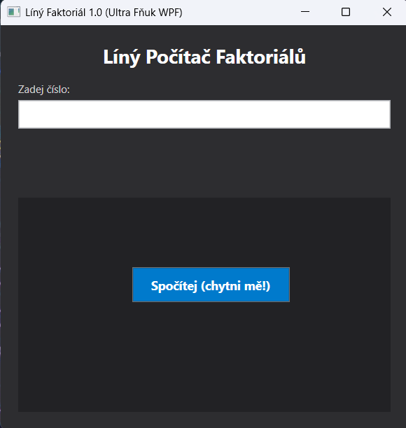
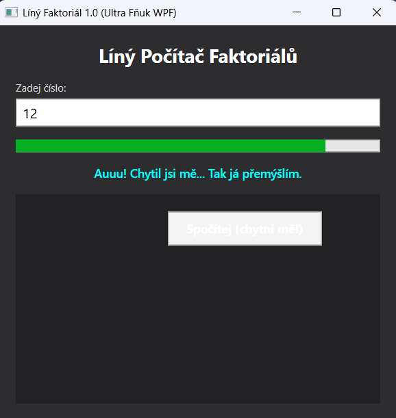
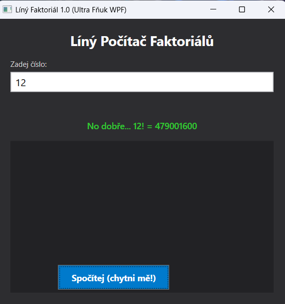

# README – Líný Faktoriál WPF (Ultra Fňuk GUI Edition™)

## O projektu

Líný Faktoriál opustil temná zákoutí konzole a dostal moderní, grafické a bezostyšně urážející rozhraní ve **WPF (Windows Presentation Foundation)**.

Tato verze nepřináší jen obyčejný výpočet faktoriálu. Přináší **test vašich reflexů, trpělivosti a nervové soustavy**. Program je líný, odmlouvá v okouzlujícím tmavém režimu a udělá cokoliv pro to, aby nemusel pracovat – včetně fyzického útěku tlačítka před vaším kurzorem.

---

## Novinky ve WPF Edici

- **Esportové Tlačítko (Reflex Test™):** Tlačítko pro výpočet má víc než 70% šanci, že vám uskočí pod rukou. Pro kliknutí budete potřebovat schopnosti z Counter-Strike nebo Aim Labu.
- **Asynchronní Přemýšlení (`async`/`await`):** Animovaný `ProgressBar` vizuálně simuluje těžkou myšlenkovou práci. Vzhledem k použití `Task.Delay` okno nikdy nezamrzne a spotřebovává celých 0 % CPU.
- **Tmavý Režim (Dark Mode):** Protože fňukat a stěžovat si na práci vypadá v tmavém designu prostě lépe.
- **Nulové blokování UI:** Během přemýšlení můžete oknem libovolně posouvat, minimizovat ho nebo přemýšlet nad svými životními volbami.

---

## Jak to funguje

1. Zadáte číslo do pole.
2. Pokusíte se myší najet na tlačítko.
3. Tlačítko pravděpodobně uskočí na náhodné místo na hřišti (`Canvas`).
4. Když ho po 10 minutách chytíte a kliknete:
   - Zjistí, že je víkend $\rightarrow$ odmítne.
   - Zjistí, že už 3x počítal $\rightarrow$ vyhlásí stávku.
   - Má špatnou náladu $\rightarrow$ pošle vás pryč.
   - Nebo spustí animaci přemýšlení a výsledek vám nakonec (s kecama) dá.

---

## Ukázka kódu (Útěk tlačítka v XAML & C#)

### XAML Layout:

```xml
<!-- Canvas funguje jako hřiště pro utíkající tlačítko -->
<Canvas Background="#222225" Grid.Row="1" x:Name="hlavniPlatno">
    <Button Click="BtnSpocitej_Click" Content="Spočítej (chytni mě!)" Height="40" MouseEnter="BtnSpocitej_MouseEnter" Width="180" x:Name="btnSpocitej"/>
</Canvas>
```

---

### Logika útěku (C#):

```csharp
private void BtnSpocitej_MouseEnter(object sender, MouseEventArgs e)
{
    // Tlačítko uskočí na novou náhodnou pozici uvnitř okna
    if (rng.NextDouble() < 0.75) // 75% šance na útek!
    {
        double maxLeft = hlavniPlatno.ActualWidth - btnSpocitej.ActualWidth;
        double maxTop = hlavniPlatno.ActualHeight - btnSpocitej.ActualHeight;

        Canvas.SetLeft(btnSpocitej, rng.NextDouble() * maxLeft);
        Canvas.SetTop(btnSpocitej, rng.NextDouble() * maxTop);
    }
}
```

---

## Požadavky na systém

- .NET 8.0 nebo novější
- Windows 10 / 11
- Rychlá myš a dobré reflexy (doporučeno DPI 1200+)

## Licence
Projekt je licencován pod FňukLicense 1.0:
- „Můžeš to používat, ale pokud tlačítko nechytneš, je to tvůj problém.“

## Releases
**v1.0.0** – Oficiální WPF Release!
- Kompletní přechod z konzole do grafického rozhraní (WPF / XAML).
- Utíkající tlačítko reagující na pohyb myši (MouseEnter).
- Plynulý asynchronní ProgressBar simulující přemýšlení.
- Zachován víkendový režim, únava po 3 výpočtech a paměť výsledků (Dictionary<int, int>).
[Stáhnout zde](https://github.com/AdriansRepos/LinyFaktorialWpf/releases/tag/v1.0)

---

### 📸 Ukázky aplikace

#### Start aplikace



#### Počítání faktoriálu



#### Výsledek výpočtu

